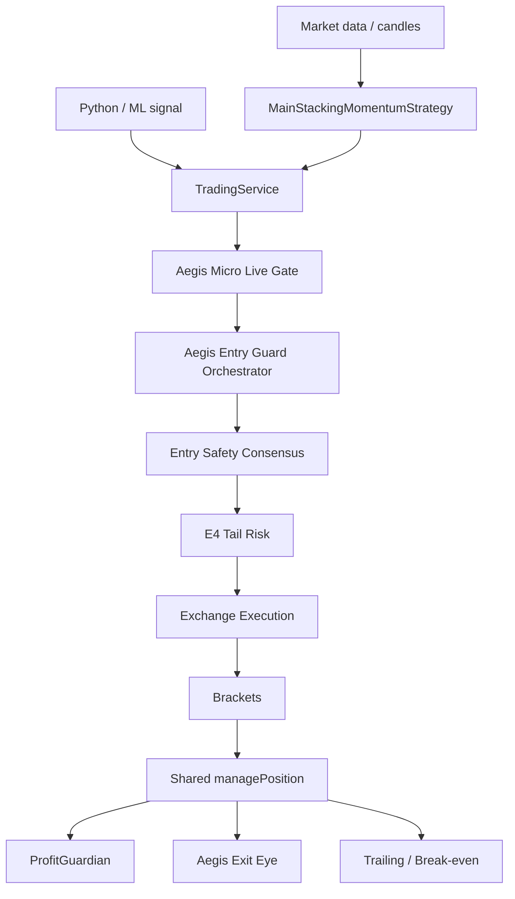
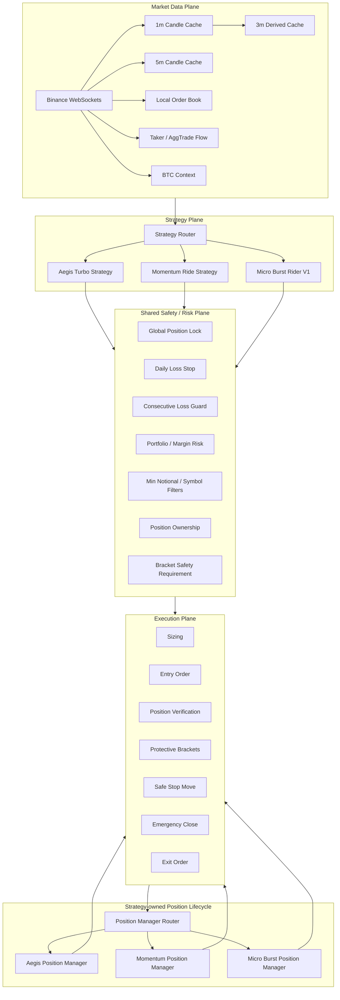
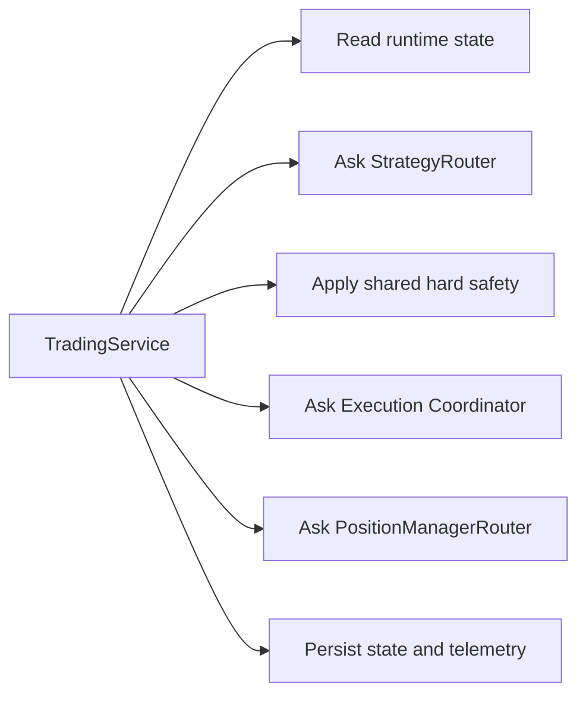
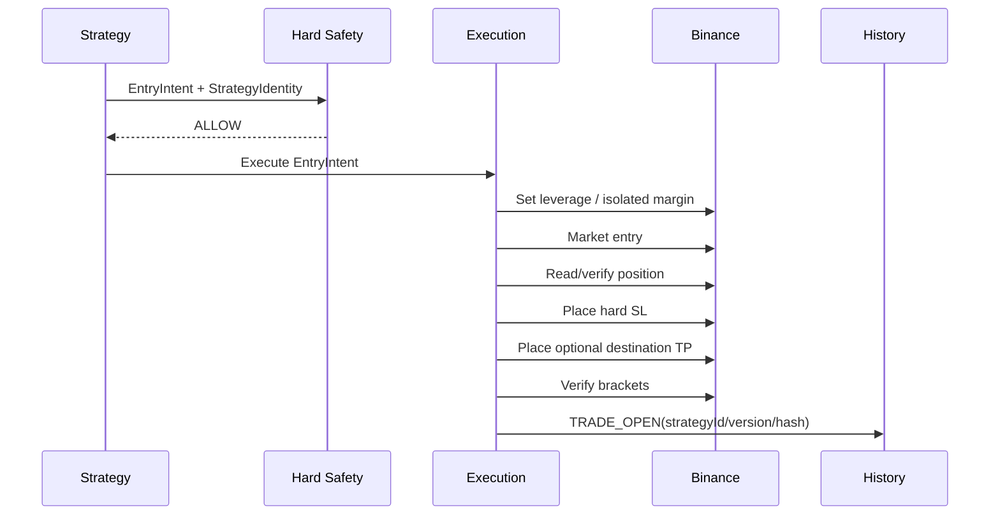
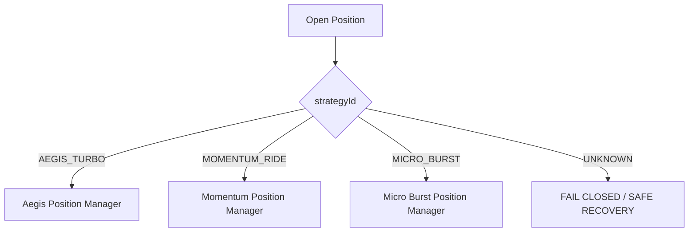
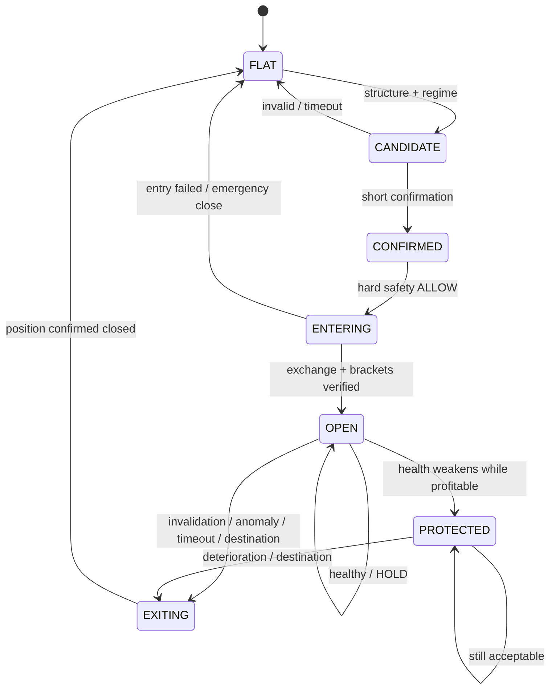

# TypeScript Trading Runtime Architecture

> **Status:** CURRENT IMPLEMENTATION MAP + TARGET BOUNDARIES
> **Branch:** `work/micro-burst-rider-v1-20260826`  
> **Parent branch:** `work/ts-multisymbol-momentum-20260826`  
> **Purpose:** distinguish connected runtime components from intended but incomplete platform boundaries.

This is the canonical architecture document. The runtime already contains several strategy-neutral data, risk, execution, ownership, shadow and replay components; it is not a plan to implement Micro from scratch.

This document does not authorize trading or imply that a proposed/typed boundary is connected. Mode, operational configuration, existing live safety, and runtime code remain the only execution authorities. Micro is used as a technically verifiable reference; no profitability is inferred.

## Implemented today

- `StrategyRouter` evaluates typed entry adapters and records observational evidence. Micro and
  Momentum register here through separate typed routers because their contexts are different.
- `PositionManagerRouter` routes by persisted strategy identity and fails closed on missing owner.
- `SharedStrategyExecutionService`, `SharedEntryReservation`, and existing safety coordinators
  own live execution admission/mutation. A strategy intent alone grants no authority.
- `StrategyRuntimeCoordinator` owns `SharedMarketDataRuntime`; Aegis, Momentum, and the
  integrated Micro runtime can consume canonical order-book/AggTrade state through leases.
- `ShadowTradingEngine` is a strategy-keyed, recoverable paper lifecycle. Micro's paper/exit
  adapter uses it; replay uses the same `MicroBurstStrategy`/entry policy as runtime.
- `MicroBurstCaptureSession` and paired replay verify manifests, inputs, snapshots, sequence
  chains and interval evidence. UNKNOWN is preserved and remains separate from execution claims.

## Still partial or disconnected

- `EntryStrategy.contract` now describes identity-bound config, required inputs, warmup, entry
  state recovery and position-manager ownership for Micro/Momentum. It is metadata, not yet an
  automatic feed-acquisition/readiness compiler; legacy Aegis entry orchestration remains
  outside this generic router.
- `MarketDataCapabilityCatalog` / consumer profiles and neutral snapshot composition are tested
  but not wired into the decision contexts. Do not describe them as the active runtime path.
- Micro consumes the shared depth/AggTrade planes when built by `StrategyRuntimeCoordinator`,
  but its `MicroBurstContextBuilder` still uses raw exchange REST candles and a single
  exchange-as-of boundary. The shared streaming candle plane has different closure/availability
  semantics; no silent substitution is valid until parity is demonstrated.
- `SharedStrategyExecutionService` still has Micro-specific contextual sizing/policy validation;
  `TradingService` still composes strategy-specific authorities. These remain explicit
  extraction seams, not a reason for a parallel framework.
- The typed feature-vector/model-prediction contracts are only future-facing types. No Python,
  ONNX Runtime, model loading, or inference service is part of this runtime.

---

## 1. Architectural objective

The bot must stop treating every trading idea as if it were an Aegis Turbo signal.

The target architecture separates four concerns:

1. **Market Data Plane** — receives and maintains the freshest causal market state.
2. **Strategy Plane** — decides whether a strategy has an actionable setup and owns the strategy-specific lifecycle.
3. **Safety / Risk Plane** — applies non-negotiable operational constraints independent of strategy alpha.
4. **Execution Plane** — interacts with Binance, verifies positions, creates/replaces protective orders, and closes safely.

The central rule is:

> **A strategy owns its trading hypothesis. The shared runtime owns exchange safety.**

Aegis Turbo, Momentum Ride, and Micro Burst must be able to coexist without pretending to be each other and without sharing strategy-specific exit logic accidentally.

---

## 2. Earlier coupled-flow baseline (historical)

The parent branch `work/ts-multisymbol-momentum-20260826` introduced standalone Momentum entry, but downstream gates were then more tightly coupled to Aegis.

That earlier architecture looked approximately as follows; it is not a complete diagram of the current strategy paths:



This gives us useful infrastructure reuse, but it is not the target architecture for independent strategies.

---

## 3. Target high-level architecture



The strategy router chooses **who is allowed to propose an entry**. The position manager router chooses **who owns the open trade lifecycle**.

These are separate decisions.

---

## 4. Core invariant: strategy ownership is immutable per trade

Every bot-owned trade must carry a canonical strategy identity from entry creation until final close.

Example target identity:

```ts
interface StrategyIdentity {
  strategyId: 'AEGIS_TURBO' | 'MOMENTUM_RIDE' | 'MICRO_BURST';
  strategyVersion: string;
  strategyHash: string;
}
```

Once an order is submitted, `strategyId`, `strategyVersion`, and `strategyHash` may not be silently rewritten.

The same identity must appear in:

- runtime state;
- `TRADE_OPEN` history;
- every lifecycle decision event;
- bracket/protection events;
- `TRADE_CLOSE` history;
- metrics and analytics exports.

A trade opened by Momentum must not later be recorded as Aegis Turbo. A Micro Burst trade must not silently inherit an Aegis lifecycle because a shared method happens to be called.

---

## 5. Target source-code boundaries

This is a **proposed layout**, not an instruction to move files yet.

```text
src/
├── app/
│   ├── services/
│   │   └── TradingService.ts
│   ├── strategy/
│   │   ├── StrategyRouter.ts
│   │   └── PositionManagerRouter.ts
│   └── execution/
│       └── TradingExecutionCoordinator.ts
│
├── domain/
│   ├── strategies/
│   │   ├── aegis-turbo/
│   │   │   ├── AegisTurboStrategy.ts
│   │   │   └── AegisTurboPositionManager.ts
│   │   ├── momentum-ride/
│   │   │   ├── MomentumRideStrategy.ts
│   │   │   └── MomentumRidePositionManager.ts
│   │   └── micro-burst/
│   │       ├── MicroBurstStrategy.ts
│   │       ├── MicroBurstRegime.ts
│   │       ├── MicroBurstStructure.ts
│   │       ├── MicroBurstMomentum.ts
│   │       ├── MicroBurstOrderBook.ts
│   │       ├── MicroBurstBtcContext.ts
│   │       ├── MicroBurstTradeHealth.ts
│   │       └── MicroBurstPositionManager.ts
│   │
│   ├── risk/
│   │   ├── GlobalPositionGuard.ts
│   │   ├── DailyLossGuard.ts
│   │   ├── PortfolioRiskGuard.ts
│   │   └── PositionOwnership.ts
│   │
│   └── execution/
│       ├── ProtectiveBracketPolicy.ts
│       └── SafeStopPolicy.ts
│
└── infra/
    ├── exchange/
    ├── market-data/
    │   ├── CandleCache.ts
    │   ├── MultiTimeframeCache.ts
    │   ├── LocalOrderBook.ts
    │   └── TradeFlowCache.ts
    ├── logging/
    └── config/
```

The final directory names can change later. The important part is the ownership boundary.

---

## 6. TradingService target responsibility

`TradingService` should gradually become an orchestrator rather than the place where every strategy rule lives.

Target responsibilities:



`TradingService` should **not** eventually contain:

- Micro Burst regime formulas;
- Momentum pattern formulas;
- Aegis-specific alpha interpretation;
- strategy-specific exit thresholds;
- strategy-specific anomaly rules.

It may coordinate these modules but should not own their business logic.

---

## 7. Market Data Plane

Micro Burst is sensitive to latency. The target is an event-driven in-memory market state.

### Slow / structural state

Updated primarily from completed candles:

- 1m completed candles;
- derived or native 3m completed candles;
- 5m completed candles;
- support/resistance state;
- ATR / volatility state;
- regime state;
- BTC structural context.

### Fast / microstructure state

Updated from WebSocket events without REST calls in the hot decision path:

- best bid / ask;
- spread;
- depth imbalance;
- local order-book levels;
- microprice;
- taker buy/sell pressure;
- liquidity depletion / replenishment;
- short-horizon price acceleration.


### Latency rule

A strategy evaluation must not require a REST candle download on every scan/tick.

REST remains valid for:

- startup bootstrap;
- gap recovery;
- reconciliation;
- non-hot-path diagnostics.

---

## 8. Strategy Router

The router determines which strategy currently has entry authority.

Target modes:

```ts
type StrategyMode = 'OFF' | 'SHADOW' | 'LIVE';
```

Example desired configuration concept:

```yaml
strategies:
  aegis_turbo:
    mode: OFF
  momentum_ride:
    mode: OFF
  micro_burst_v1:
    mode: SHADOW
```

Only strategies explicitly in `LIVE` may request execution.

`SHADOW` strategies may calculate and log decisions but may not mutate position/order state.

The router must never convert one strategy's candidate into another strategy's signal contract solely to reuse downstream code.

---

## 9. Shared hard-safety boundary

Hard safety is not alpha and may be shared.

Initial proposed shared controls:

- symbol is explicitly authorized;
- global/runtime live switch;
- strategy mode is `LIVE`;
- exchange connectivity/state is healthy;
- position ownership is known;
- global single-position rule when configured;
- max trades / cooldown where configured;
- daily realized-loss stop;
- consecutive-loss circuit breaker;
- maximum account/margin exposure;
- valid leverage and isolated margin;
- exchange symbol filters;
- minimum notional;
- quantity/price rounding;
- hard protective stop required;
- bracket placement verification;
- fail closed if mandatory protection cannot be established;
- emergency close after unverified/unsafe entry state.

A strategy-specific filter must not be disguised as hard safety.

Examples that are **not automatically shared hard safety**:

- Aegis DecisionBrain;
- Aegis EntryQuality;
- Aegis CleanEntry;
- Momentum Ride pattern requirements;
- Micro Burst TradeHealth;
- strategy-specific BTC confirmation;
- strategy-specific regime interpretation.

---

## 10. Execution Plane

The execution layer must be strategy-agnostic.

Input example:

```ts
interface EntryExecutionRequest {
  strategy: StrategyIdentity;
  symbol: string;
  side: 'LONG' | 'SHORT';
  leverage: number;
  requestedRisk: number;
  hardStopPrice: number;
  destinationPrice?: number;
  metadata: Record<string, unknown>;
}
```

The execution plane is responsible for operational correctness, not for deciding whether the market setup is attractive.

### Entry sequence



### Failure principle

If the runtime cannot verify an opened position or establish mandatory protection, the system must fail closed and attempt a safe emergency close.

---

## 11. Protective brackets versus strategy exits

The architecture distinguishes **exchange-resident disaster protection** from **strategy-owned active management**.

### Shared exchange protection

Every leveraged live strategy should normally have a hard stop placed at Binance immediately after entry and verified.

Its purpose is survival if:

- Node crashes;
- network connectivity disappears;
- WebSocket freezes;
- position manager throws;
- runtime state becomes unavailable.

### Strategy-owned lifecycle

The strategy may later:

- tighten the stop;
- protect profit;
- exit at market;
- exit at destination;
- apply a strategy-specific trailing mechanism.

Shared helpers such as safe stop replacement may be reused. Shared **rules deciding when** to move the stop may not be reused unless explicitly included in the strategy contract.

---

## 12. Position Manager Router

After an entry is verified, the open trade must be routed using immutable strategy ownership.



No manager may silently manage a position owned by another strategy.

Unknown ownership must generate explicit telemetry and a conservative recovery path.

---

## 13. Micro Burst lifecycle boundary

Micro Burst is expected to own its complete trading hypothesis:



Legacy Aegis Exit Eye and ProfitGuardian are **not automatically part of this lifecycle**.

If any existing helper is reused, we distinguish:

- **mechanism reuse:** allowed, e.g. `safeMoveCloseStop`;
- **policy reuse:** not allowed unless explicitly frozen into Micro Burst's strategy contract.

---

## 14. Global single-position experiment mode

For Micro Burst V1, the initial design target is one Micro Burst position globally, not one per symbol.

Conceptually:

```text
MICRO_BURST_POSITION_OPEN = false -> entry scanning allowed
MICRO_BURST_POSITION_OPEN = true  -> all new Micro Burst entries blocked
```

This reduces overlapping exposure and makes early evidence easier to attribute.

Whether other strategies may trade concurrently is a separate configuration decision. During the initial Micro Burst experiment the preferred research configuration is that Aegis Turbo and Momentum Ride have no live entry authority.

---

## 15. State and event model

Every lifecycle-changing decision should be observable.

Minimum event families:

```text
STRATEGY_CANDIDATE
STRATEGY_REJECTED
STRATEGY_CONFIRMED
HARD_SAFETY_DENIED
ENTRY_INTENT_CREATED
ORDER_SUBMITTED
POSITION_CONFIRMED
BRACKETS_CONFIRMED
POSITION_HEALTH
POSITION_PROTECTED
EXIT_INTENT_CREATED
TRADE_CLOSED
EMERGENCY_CLOSE_ATTEMPT
EMERGENCY_CLOSE_SUCCESS
EMERGENCY_CLOSE_FAILED
```

Each strategy-derived event should contain:

```json
{
  "strategy_id": "MICRO_BURST",
  "strategy_version": "...",
  "strategy_hash": "sha256:...",
  "decision_reason": "...",
  "input_timestamp": "...",
  "causal_data_watermark": "..."
}
```

The causal watermark exists to make it possible to prove what market information was available when the decision was made.

---

## 16. Recovery and restart semantics

Runtime restart must never infer strategy ownership from current market direction.

Recovery order:

1. inspect exchange positions;
2. read persisted bot state/history;
3. establish ownership identity;
4. verify protective orders;
5. route to the correct position manager;
6. if ownership cannot be established, enter explicit recovery mode rather than assigning an arbitrary strategy.

Manual/external positions remain distinct from verified bot-owned positions.

---

## 17. Scientific reproducibility requirements

Every strategy revision must be attributable to an immutable definition.

A trade is not reproducible if we know only:

```text
strategy = MICRO_BURST
```

We need:

```text
strategy_id
strategy_version
strategy_hash
config_hash
code_commit_sha
market_data timestamps
```

The detailed strategy hash contract is defined in [`STRATEGY_CONTRACTS.md`](./STRATEGY_CONTRACTS.md).

---

## 18. What this architecture deliberately avoids

We do not want:

```text
Strategy A
   -> forge Strategy B signal
   -> pass through Strategy B guards
   -> use Strategy B exit manager
   -> record trade under Strategy B
```

We want:

```text
Strategy A
   -> Strategy A decision
   -> common hard safety
   -> common execution mechanism
   -> Strategy A position manager
   -> Strategy A attribution
```

This separation is the principal architectural objective of the branch.

---

## 19. Remaining architecture work

The current incremental boundary still leaves `TradingService` responsible for much of the
application composition, Aegis uses its legacy orchestration rather than `EntryStrategy`, and
Micro builds its own REST candle context. Shared data contracts do not yet provision feeds or
readiness automatically from `StrategyRuntimeContract`. `MIGRATION_STATUS.md` records these
remaining seams and their validation status.

The next low-risk cuts should preserve existing policy functions, use the same Micro evaluator
in runtime/paper/replay, and keep risk/ownership authority in the existing shared services.
Unknown ownership, incomplete data, and unverified replay intervals remain fail-closed. Any
later live authority/policy changes require a separate explicit task.
